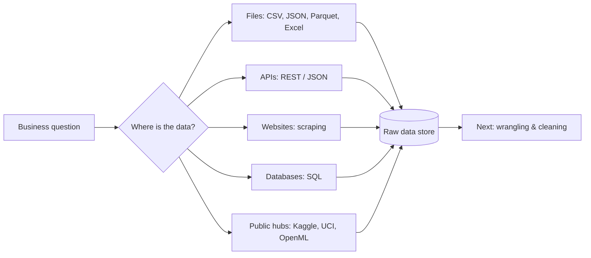

Every ML project starts with a question **and the data to answer it**. In industry, collecting and preparing data
takes most of the time - models are the easy part.

Questions to ask about any data source:
1. **Is it representative** of the cases the model will see in production?
2. **Is it legal and ethical** to use (licence, terms of service, personal data / GDPR)?
3. **How fresh** is it, and can you get it again tomorrow (reproducibility)?
4. **How was it labelled**, and how noisy are the labels?
