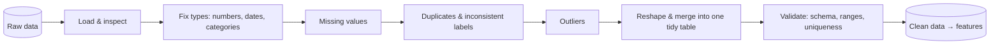

> "Data scientists spend 80% of their time cleaning data." The number is debated - the reality isn't.

**Tidy data** (Hadley Wickham, 2014): every *column* is one variable, every *row* is one observation, every *cell* is one value.
Almost every ML library expects a tidy table.

All lessons in this part use `data/messy_customers.csv`, a deliberately dirty dataset (mixed date formats,
"N/A"/"?" codes, duplicates, impossible ages, `$`-formatted incomes, heights in two units, `yes/Y/1` labels).
