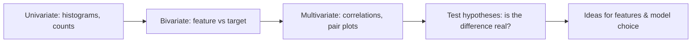

EDA is a conversation with the data. Its goals:
1. **Understand** each variable (type, range, distribution, missingness).
2. **Find relationships** between features and with the target.
3. **Spot problems** - leakage, outliers, imbalance, data errors - before they reach the model.
4. **Generate hypotheses** for feature engineering.

