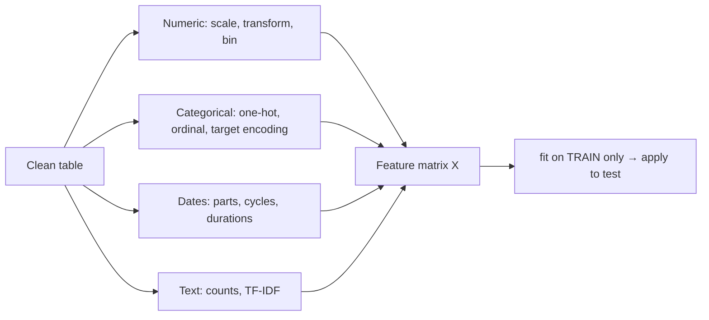

> "Coming up with features is difficult, time-consuming, requires expert knowledge. Applied machine learning is basically feature engineering." - Andrew Ng

A good feature makes the pattern **easy** for the model to learn. A linear model can't learn $\text{price} \propto \text{area} \times \text{quality}$ unless you give it that product; a distance-based model can't compare dollars with years unless you scale them.

**Rule #1 of feature engineering:** every statistic (mean, scale, category list, target mean) is learned from the
**training data only**, then applied unchanged to validation/test data. Breaking this rule is called *leakage*.
