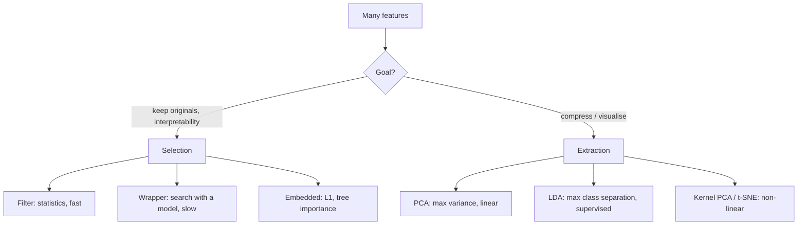

Two different ideas, often confused:

| | **Feature selection** | **Feature extraction** |
|-|------------------------|------------------------|
| Output | a **subset** of the original columns | **new** columns, combinations of the originals |
| Interpretable? | yes - same features | less - "PC1 = 0.6·area + 0.4·rooms…" |
| Examples | variance threshold, χ², mutual information, RFE, Lasso | PCA, LDA, kernel PCA, t-SNE, autoencoders |

Why reduce dimensions at all?
- **Curse of dimensionality**: in high dimensions all points are far apart, so distance-based methods weaken and you need exponentially more data.
- **Overfitting**: noise features give the model more ways to memorise the training set.
- **Speed and cost**: fewer features = faster training, cheaper data collection.
- **Visualisation**: you can only look at 2-3 dimensions.

