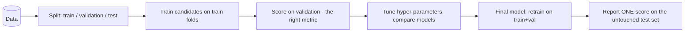

A model is only as good as the evidence that it works on **data it has never seen**. This part comes *before* the
algorithms on purpose: every algorithm lesson uses these tools to judge itself.

| Problem | Typical metrics |
|---------|-----------------|
| Regression | RMSE, MAE, R², MAPE |
| Balanced classification | accuracy, log-loss, ROC-AUC |
| Imbalanced classification | precision, recall, F1, PR-AUC, cost-weighted |
| Clustering | silhouette, inertia, adjusted Rand (if labels exist) |
