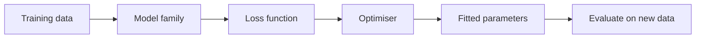

Regression learns a function $f: \mathbb{R}^d \to \mathbb{R}$ from examples $(x_i, y_i)$. Every algorithm here answers
the same three questions - and you'll see them in every later algorithm too:

| Question | Linear regression's answer |
|----------|---------------------------|
| **Model** - what functions can it represent? | $\hat y = w^\top x + b$ |
| **Loss** - how do we measure a bad fit? | mean squared error |
| **Optimiser** - how do we find good parameters? | closed form (normal equation) or gradient descent |

