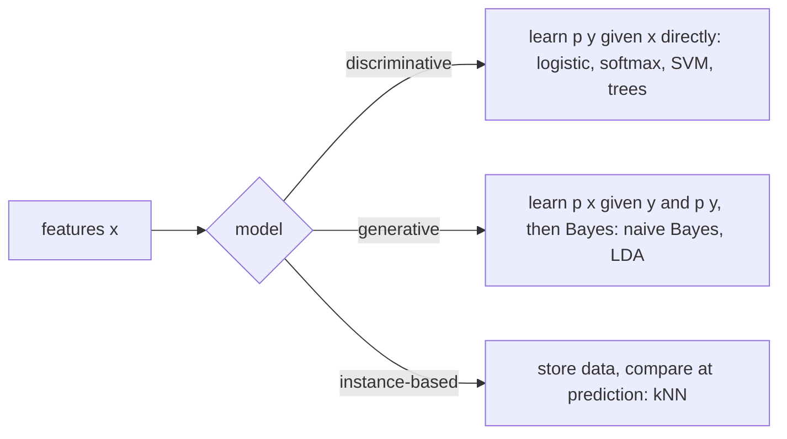

Six classic classifiers, six different ideas of what "learning a boundary" means:

| Algorithm | Idea | Boundary | Probabilities? |
|-----------|------|----------|----------------|
| Logistic regression | model log-odds as a linear function | linear | ✓ (well calibrated) |
| Softmax regression | logistic for K classes | piecewise linear | ✓ |
| k-nearest neighbours | vote of the closest examples | any shape, local | ✓ (vote shares) |
| Naive Bayes | Bayes' rule + independent features | quadratic / linear | ✓ (often over-confident) |
| SVM | maximise the margin; kernels for curves | linear or kernel | ✗ (scores) |
| Decision tree | recursive axis-aligned splits | rectangles | ✓ (leaf frequencies) |

Try all six on the same data in the [Interactive lab](/lab) → "Classifier playground".

