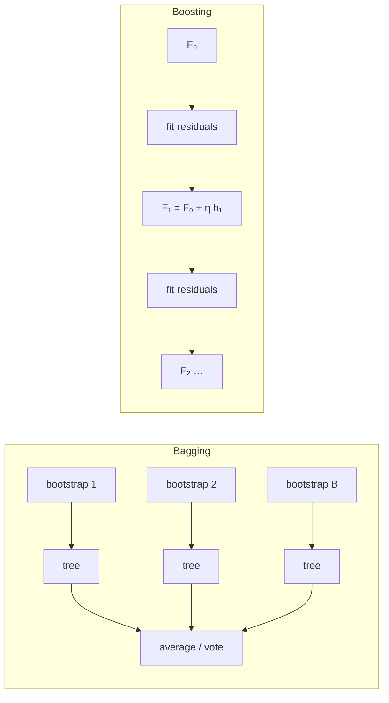

> Gradient-boosted trees and random forests win the majority of tabular-data competitions and power countless production systems.

| Family | Builds models | Each new model… | Mainly reduces |
|--------|---------------|-----------------|----------------|
| **Bagging / Random forest** | in parallel, independently | sees a bootstrap sample (+ random features) | variance |
| **Boosting** (AdaBoost, GBM, XGBoost) | sequentially | focuses on the previous models' errors | bias (and variance with shrinkage) |
| Stacking | in parallel, then a meta-model | is combined by a learned model | both |

Why averaging works: if $B$ models each have variance $\sigma^2$ and pairwise correlation $\rho$, their average has variance
$$
\rho\sigma^2 + \frac{1-\rho}{B}\sigma^2
$$
More models kill the second term; **decorrelating** them (random forests) shrinks the first.

