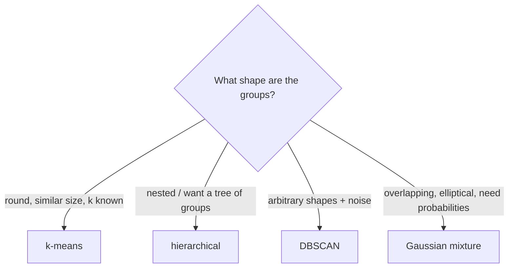

No target column - the algorithm must discover structure by itself.

| Task | Question | Algorithms here |
|------|----------|-----------------|
| **Clustering** | which samples belong together? | k-means, hierarchical, DBSCAN, Gaussian mixtures |
| **Density / anomaly detection** | which samples are unusual? | Isolation Forest, Mahalanobis, GMM likelihood |
| **Association rules** | which items occur together? | Apriori |
| Dimensionality reduction | what are the main directions of variation? | PCA, t-SNE (Part 5) |

Evaluating unsupervised results is harder: use internal measures (inertia, silhouette, BIC), stability across runs,
external labels when you have some, and above all **does the result make sense to a domain expert?**

