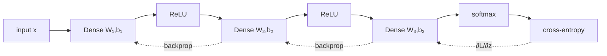

A neural network is a composition of simple differentiable functions (layers) trained end-to-end by gradient descent,
with gradients computed by **backpropagation** (the chain rule). Everything in this part is implemented in
`mlscratch/neural_network.py` - a tiny NumPy framework where each layer has `forward()` and `backward()`.

| Lesson | Builds |
|--------|--------|
| Perceptron | a single neuron and its learning rule |
| MLP & backprop | `Dense`, activations, softmax-cross-entropy, `Sequential`, gradient checking |
| Training deep networks | initialisation, SGD/momentum/Adam, dropout, batch norm, early stopping |
| CNNs | `Conv2D` (im2col), `MaxPool2D`, `Flatten` |
| RNNs | `SimpleRNN` with backprop through time |

Project 5 trains these networks on the full MNIST dataset.
