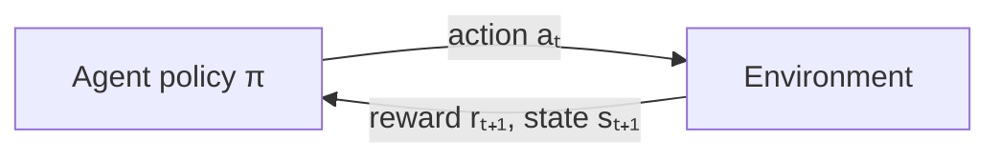

In reinforcement learning an **agent** interacts with an **environment**: it observes a state $s$, takes an action $a$,
receives a reward $r$ and a new state $s'$. Nobody tells it the right action - it must discover which behaviour
maximises long-term reward, balancing **exploration** (try new things) and **exploitation** (use what works).

| Lesson | Setting | Algorithms |
|--------|---------|------------|
| Bandits | one state, many actions | ε-greedy, UCB1, Thompson sampling |
| MDPs & dynamic programming | known model of the environment | value iteration, policy iteration |
| Q-learning & SARSA | unknown model, learn from experience | temporal-difference control |

Deep RL (DQN, policy gradients, PPO) replaces the tables here with neural networks - same equations.
